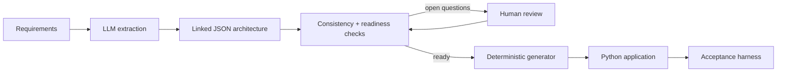

# ESUS

**Requirements in. Reviewable architecture out. A runnable Python application generated from what can be proven.**

ESUS is an experimental neuro-symbolic code generator. A small local language model turns a written requirements file into a set of linked architecture documents; a deterministic Python kernel checks those documents, asks a human only about genuine ambiguity, and generates the parts of a Python application it can implement safely. Anything it cannot implement or check safely is left as a visible `NotImplementedError` stub rather than silently guessed.

The project is a research prototype, not a production code generator.

## Why this approach

Asking a model to write an entire application in one shot hides its interpretation inside the code. ESUS makes the interpretation explicit:

- **The LLM makes small, structured decisions** — intentions, entities, errors, invariants, command surfaces, service contracts, adapters, and persistence.
- **The kernel owns what can be formalized** — contracts, CRUD, wiring, validation, and the store API.
- **The human resolves what neither can prove** — close pattern choices, ambiguous slots, conflicting surfaces, contract effects, and uniqueness policies.
- **Uncertainty stays visible** — blockers stop generation, unsupported bodies remain stubs, and model-written bodies are marked provisional.



## What it generates

For the supported Python target, the generator emits a package with models, errors, storage, repositories, services, and a CLI (or a generic `pyimgui` GUI when the architecture asks for one). Straightforward CRUD and supported patterns are generated mechanically. A method that cannot be implemented safely is left as a `NotImplementedError` stub with a reason; with `--model`, the model can attempt those bodies one at a time, and each body is checked against the confirmed contract before it is accepted.

Generated programs use SQLite through the standard library. CLI programs use `click` when the architecture declares it, otherwise `argparse`. GUI programs use `pyimgui`.

## Status

ESUS is an experimental research prototype. The stored v8 benchmark (2026-11-19) is green:

| Measure | Result |
|---|---:|
| Prompts | 66 |
| Generated | 66/66 |
| Complete acceptance projects | 66/66 |
| Acceptance checks | 3,057 passed, 2 skipped, 0 failed |
| Generated stubs | 0 |
| Unit tests | 1,486 passed |
| Canonical prompt-derived verifier | 51/51 passed, 0 failed/unbound |

The acceptance and unit-test figures are the stored v8 replay; the verifier figure is from the 2026-11-24 backlog.

The latest macOS chain (2026-11-26) is a separate run and stopped at the acceptance gate; see [`docs/final.md`](docs/final.md). The active backlog and the current limitations are in [`doc/open-points.md`](doc/open-points.md) and [`doc/checks-coverage-and-gaps.md`](doc/checks-coverage-and-gaps.md).

A clean acceptance run is not a proof of semantic correctness. The benchmark is curated, acceptance is extraction-relative, and the verifier currently shares a model family with the extractor. The docs are explicit about what each layer does and does not establish.

## Quick start

### Prerequisites

- Python 3.12+ (tested with 3.14)
- `numpy`
- A local model:
  - `llama-server` from [llama.cpp](https://github.com/ggml-org/llama.cpp), with `Qwen3-4B-Instruct-2507-Q4_K_M.gguf`, or
  - `llama-cpp-python` to load a GGUF directly.
- Optional, only for generated programs: `click` for CLI programs, and `imgui`/`glfw`/`PyOpenGL` for GUI programs.

### Install and start the model server

```bash
git clone https://github.com/stengerg-sfeir/esus.git
cd esus

python3 -m venv .venv
source .venv/bin/activate
python3 -m pip install numpy

# Optional: only needed for --model /path/to/model.gguf
python3 -m pip install llama-cpp-python

# Install llama-server from llama.cpp (for example: brew install llama.cpp)
# The default model path is ../models/Qwen3-4B-Instruct-2507-Q4_K_M.gguf
./scripts/start_llama_server.sh
```

`start_llama_server.sh` does not download models. Put the GGUF in `../models/`, or point `MODEL` at it:

```bash
MODEL=/path/to/Qwen3-4B-Instruct-2507-Q4_K_M.gguf ./scripts/start_llama_server.sh
```

The server listens on `http://127.0.0.1:8080` by default. `main.py` uses that URL unless `--server-url` or `LLAMA_SERVER_URL` says otherwise.

### Run the pipeline

```bash
python3 main.py prompts/initial/prompt_library_system.txt
```

This extracts the architecture, checks readiness, and generates the program into `out/library_system/`. The generated package is `out/library_system/generated/`; logs are in `out/library_system/logs/`.

If readiness stops on open questions, rerun with review:

```bash
python3 main.py prompts/initial/prompt_library_system.txt --review
```

Other useful forms:

```bash
# Use a GGUF directly instead of a running server
python3 main.py prompts/initial/prompt_library_system.txt --model /path/to/model.gguf

# Point at another llama-server
python3 main.py prompts/initial/prompt_library_system.txt --server-url http://127.0.0.1:8080
```

### Manual pipeline

The individual steps are available when you need to inspect or resume a run:

```bash
python3 extract_arch.py --model server --output out/library_system \
  --requirements prompts/initial/prompt_library_system.txt --check
python3 probe_readiness.py --dirs library_system:out/library_system
python3 generator.py out/library_system --model server
```

See [`doc/how-the-agent-works.md`](doc/how-the-agent-works.md#running-the-main-steps) for the review loop, resume behavior, and the exact flags.

## Validation and tests

The benchmark contains 60 validation prompts and 6 initial prompts. The validation runner records per-prompt metrics and a combined summary:

```bash
python3 scripts/run_validation.py \
  --prompts prompts/validation \
  --prompts prompts/initial
```

The generic acceptance harness runs one fresh interpreter per project against a real SQLite database:

```bash
python3 scripts/run_bench_acceptance.py out/validation/runs/<run-id>
```

The unit suite uses `unittest`:

```bash
python3 -m unittest discover -s tests -p 'test_*.py'
```

See [`doc/validation.md`](doc/validation.md) for the methodology, classification rules, and the v8 baseline.

## Repository layout

| Path | What it is |
| --- | --- |
| `main.py` | One-command pipeline: extract, check readiness, generate. |
| `extract_arch.py` | Extraction, review, repair, and resume. |
| `kernel/extraction/` | Prompts, grammars, model runner, and extraction pipeline. |
| `kernel/consistency/` | Checks over the saved architecture documents. |
| `probe_readiness.py` | Generator blockers and separate residual risks. |
| `review_*.py` | Interactive reviews for ties, slots, surface, aliases, contracts, flags, and uniqueness. |
| `generator.py`, `kernel/codegen.py` | Code generation and body checks. |
| `scripts/run_bench_acceptance.py`, `tests/runtime/` | Generic acceptance harness and runtime scenarios. |
| `prompts/initial/`, `prompts/validation/` | Initial examples and the 60-prompt validation set. |
| `doc/` | Design, validation, performance, and backlog documents. |
| `kaggle/` | Kaggle notebooks and dataset instructions for validation runs. |

## Documentation

Current:

- [How the ESUS agent works](doc/how-the-agent-works.md) — architecture, review loop, and commands.
- [What ESUS checks, what it covers, and what is missing](doc/checks-coverage-and-gaps.md) — what a clean check establishes, and what it does not.
- [Active backlog](doc/open-points.md) — current status, open work, and the definition of done.
- [Validation of the 66-prompt suite](doc/validation.md) — methodology and the v8 baseline.
- [Performance notes](doc/speed.md) — measured timings and speed levers (2026-11-19 snapshot).
- [Verifier kernel plan](doc/verifier-kernel-plan.md) — prompt-derived verifier design and trial results.
- [Latest macOS chain report](docs/final.md) — the 2026-11-26 run report.

Historical, not current guidance:

- `doc/archive/` — superseded behavioral review, library fix plan, and old open points.
- [Validation triage](doc/validation-triage.md) — the 2026-11-13 triage of 10 non-generatable prompts, with its 2026-11-14 resolution.
- [Consolidated audit findings](doc/esus_findings_consolides.md) — a French audit snapshot of an older archive; line references may not match the current code.

## Project history

The project was restarted from scratch in November 2026. The previous repository state is preserved on the `archive/legacy-main` branch and the `archive/legacy-main-2026-11-26` tag.

## Contributing

This is an experimental research prototype. Issues and pull requests are welcome, but there is no stability or compatibility guarantee.
