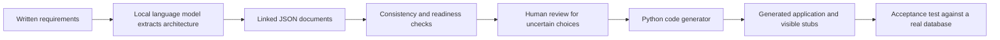

# How the ESUS agent works

This guide describes the current code in simple terms. The project turns written software requirements into an architecture description, checks that description, and generates the parts of a Python application it knows how to build.

## The short version

The agent does not ask a language model to write an entire application in one shot. It uses a local language model to make a series of smaller decisions, saves those decisions as JSON files, checks that they fit together, and then uses Python code to generate supported parts of the application.



The human review stage is used with `--chat`. Without it, the extraction and checks can be run separately, and the generator still refuses output with blockers or unanswered ties.

## How a run works

### 1. Give it requirements and a model

The input is a text description of the program. The extractor also needs a local GGUF model file, which it loads through `llama.cpp` using `llama-cpp-python`.

### 2. Turn the description into architecture documents

The extractor asks the model for one kind of information at a time. It records the results as JSON documents, including:

- the program's key phrases and intentions;
- data entities and their fields;
- application error types and business rules;
- the program's interface and command-line surface;
- service methods and their inputs and outputs;
- method-pattern classifications;
- mappings from user actions to service methods; and
- persistence interfaces when the program needs to store data.

Each step can use names produced by earlier steps. For example, a service method can refer to an entity from the data model. The extractor uses JSON grammars to restrict the structure of its answers and, in many steps, the names it can choose. This reduces mismatches between documents, but it cannot guarantee that the model interpreted the requirements correctly.

When the requirements nest commands more than two words deep (for example `expense category add`), a subcommand name can be a path. The prompt then shows the model each command line already filed, and a deterministic repair rebuilds the command tree from the requirement lines, because the small model tends to flatten it. The generated CLI nests command groups to match. Prompts with shallow command lines are not affected.

If a step produces invalid JSON or hits its output limit, the extractor can retry it. The run log records generation, retries, and repairs. A run can also resume from a selected step using the saved documents.

### 3. Check the documents

The consistency checker looks for problems such as malformed JSON, unknown names, mismatched fields or keys, missing interface methods, and disagreements between the declared command line and the requirements it can inspect.

The readiness probe adds the generator's practical needs. It checks that commands have methods behind them, that every required option has exactly one effective adapter mapping and agrees with the type of the parameter it feeds, that required input fields can be supplied, that every required model field can be set by its repository's `create`, that an ID filter has a real relation field behind it, that recorded method contracts neither write a primary key nor contradict themselves, and that no human question is still open. It reports blockers separately from lower-confidence or other residual risks. A residual risk (a close pattern choice, a low-confidence match, a method no pattern covers) describes how a method was generated; it is not a defect by itself.

These checks answer “do the documents fit together well enough for this generator?” They do not prove that every requirement was captured or that the program's business behavior is correct.

### 4. Resolve uncertain choices

With `--chat`, the tool runs the readiness probe and asks a person about what no deterministic repair may decide. The reviews run in this order, and each answer is saved beside the documents (stamped with the hash of the requirements, so an answer from an older prompt is dropped and asked again):

1. **Ties** (`review_ties.py`): close method-pattern choices.
2. **Slots** (`review_slots.py`): the missing details of a supported pattern, such as which field a filter reads.
3. **Surface** (`review_surface.py`): a subcommand that duplicates a top-level command (`borrow book` beside `borrow`), a subcommand that repeats its own parent's flags (`return loan` beside `return`), and a flag that parses but selects nothing. Deleting a node or a flag is never done unasked.
4. **Aliases** (`review_aliases.py`): which model field an action's input feeds.
5. **Contracts** (`review_contracts.py`): what a method that changes data must do. It proposes effects (a field set, incremented or decremented), the record a method creates, preconditions implied by declared errors, a related model's field a search must read, and a value the returned records carry without being saved (an overdue status derived on read). The person confirms or drops each proposal and answers what the text cannot settle: the amount, the value, the order, and the condition behind an error. A condition is a Python expression that is pasted into the generated code, so it may only use names that exist in that method (a service reaches data through `self._repos[...]`, a repository through `self._store`); `skip` allows the operation with no check.

The loop then resumes the relevant extraction step when that can help. It keeps a rerun only when the blocker count improves; otherwise it restores the previous documents.

A question that does not fit (a flag the answer would delete although the requirements require it, a condition the prompt does not define) can be skipped; `skip` leaves it open and the probe keeps reporting it. Some blockers cannot be answered in a review question. They need a clearer requirement or a change to the code.

### 5. Generate Python code

`generator.py` first checks readiness. If blockers or unanswered ties remain, it refuses to generate the application.

For accepted architecture documents, the generator creates a `generated/` directory with Python modules for models, errors, storage, repositories, services, and the command-line interface. It generates straightforward data operations and supported patterns mechanically: reads, filters, creates, updates, deletes, a read of one record by its key, and a service method that only delegates to a repository. A service method that changes several records is wrapped in one store transaction when its confirmed contract has more than one write. It reports how many method bodies were implemented and how many remain stubs.

What the emitter cannot write safely is first left as an explicit `NotImplementedError` stub with a reason in the docstring. With `--model` (a GGUF file, or `server` for a running `llama-server`), the model then writes those bodies one at a time. A body is accepted only if it passes the checks described in [What ESUS checks](checks-coverage-and-gaps.md); a refused body gets up to two repair asks that quote the complaint, and if it is still refused the stub stays. An accepted body is tagged `[llm-written ... review]` in its docstring and is **provisional**: the checks cover structure and the confirmed contract, not behavior. Without `--model`, or when a body is refused, the stub remains visible rather than silently guessing an implementation.

Scope limits in the current code generator:

- the command-line program uses `click` when the architecture declares `click`, and Python's standard-library `argparse` otherwise;
- a no-value flag that was not given is not passed to the method, so the method's own default applies;
- generated GUIs are generic `pyimgui` CRUD screens. Other GUI technologies and bespoke screen behavior are not currently generated.

If the architecture is clean but empty, `generator.py --model MODEL.gguf` uses a separate language-model fallback to write a single `app.py` directly from the requirements. That path does not use the detailed architecture-to-code generation path, so its result needs especially careful review.

## One command: `main.py`

```bash
python3 main.py prompts/initial/prompt_library_system.txt
```

`main.py` runs the whole pipeline on one prompt file: it extracts the architecture, checks readiness, and, if the documents are ready, generates the program. It hides the two scripts' messages and shows only the major steps, each with an ok or KO status, and a rolling spinner while one runs:

```text
ESUS  prompt_hello_world.txt  ->  out/hello_world
[ ok ] Check inputs                0s  model: llama-server http://127.0.0.1:8080
[ ok ] Extract architecture        4s  5 steps, 176 tokens
[ ok ] Readiness                   0s  0 blockers (unreviewed: no human review ran)
[ ok ] Generate code               1s  app.py written directly from the requirements (the architecture was empty); review it carefully
Done in 5s
  program: out/hello_world/generated
  logs:    out/hello_world/logs  (+ out/hello_world/run.log)
```

A prompt whose extraction leaves open questions stops at readiness. Both outputs here are real runs; this one is `prompts/initial/prompt_expenses.txt`:

```text
ESUS  prompt_expenses.txt  ->  out/expenses
[ ok ] Check inputs                0s  model: llama-server http://127.0.0.1:8080
[ ok ] Extract architecture    6m 13s  9 steps, 12,994 tokens
[ KO ] Readiness                   0s  4 blocker(s), 0 open tie(s)
         [ignored_cli_option] interaction_adapters: expense report: --year — no adapter field reads it; the option parses but is not consumed by an effective action
         [open_human_review] 1 unanswered method contracts; run the attended review before generation
         [open_human_review] 1 unanswered pattern slots; run the attended review before generation
         [open_human_review] 1 unanswered surface questions; run the attended review before generation
         full log: out/expenses/logs/extract.log
         to answer the open questions, run again with --review
```

Everything the scripts print is saved in the output folder: `logs/extract.log`, `logs/generate.log`, `logs/summary.txt`, and the extractor's own `run.log`. The output folder defaults to `out/<prompt name>` without the `prompt_` prefix; an existing folder is re-extracted in place and keeps its recorded review answers. On a failure the step shows KO with the reason and the log to read, and the exit code says where it stopped (1 extraction or readiness, 2 generation, 3 bad inputs, 130 interrupted).

- By default the extraction is **unreviewed**, because the review asks questions and a hidden run cannot answer them. The readiness line says so. When the verdict is `GENERATABLE: NO` (the extractor itself exits 0 in that case, so `main.py` reads the verdict from its summary), run again with `--review`.
- `--review` runs the extraction attached to the terminal, shows its output instead of the spinner, and lets you answer the questions described in step 4.
- `--verbose` shows every message instead of the spinner.
- `--model` is `server` by default (a running `llama-server`, checked first; `--server-url` or `$LLAMA_SERVER_URL` points elsewhere) or the path of a GGUF file.

`main.py` does not run an acceptance test; see "Verifying the generated program" below.

## Running the main steps

Replace the model and requirements paths with files on your machine:

```bash
python3 extract_arch.py \
  --model /path/to/model.gguf \
  --output out/my-app \
  --requirements prompts/my-app.txt \
  --check
```

To include the interactive review loop, add `--chat`. The requirements must be passed with `--requirements` in that mode so standard input stays available for review answers.

To use an already-running `llama-server` instead of loading the GGUF in the extractor, pass `--model server`:

```bash
llama-server -m /path/to/model.gguf -c 16384 -ngl 99 -fa on --port 8080 -np 1
LLAMA_SERVER_URL=http://127.0.0.1:8080 \
  python3 extract_arch.py --model server --output out/my-app \
    --requirements prompts/my-app.txt
```

`LLAMA_SERVER_URL` defaults to `http://127.0.0.1:8080`; the server's context size and native grammar sampler are used. `generator.py --model server` uses the same setting for body generation.

The launch script does not set `--cache-ram`; llama-server's prompt-cache default applies. The context size shapes how many tokens a body may use, so keep it the same between runs you want to compare.

A run is reproducible. With the same code, requirements, model, server flags and context size, two complete runs produce byte-identical documents, model answers and generated modules, including after the server is stopped and restarted. The one thing that differs is the output directory's name, which becomes the generated program's name. Any change to a prompt, a pattern catalogue, a check's message or a neighbouring method body changes the output, because the model sees the module text when it writes a body.

You can inspect readiness separately:

```bash
python3 probe_readiness.py --dirs my-app:out/my-app
```

When the documents are ready, generate the Python files:

```bash
python3 generator.py out/my-app
```

To let the model write the bodies the emitter refuses, add `--model server`:

```bash
LLAMA_SERVER_URL=http://127.0.0.1:8080 \
  python3 generator.py out/my-app --model server --stub-context exact --verbose
```

The generated files are written under `out/my-app/generated/`, and the raw model answers, refusals and verdicts are kept in `out/my-app/llm_stub_answers.json`. Each run moves the previous dump to `out/my-app/llm_stub_answers_runs/` before overwriting it, so truncated or refused answers remain inspectable. Read the generator's summary and inspect any reported stubs before treating the application as complete.

### Verifying the generated program

A clean readiness check does not run the program. `tests/e2e_library_acceptance.py` does, for the library prompt:

```bash
python3 tests/e2e_library_acceptance.py out/my-app
```

It runs the generated CLI in fresh processes against a temporary SQLite database, calls the methods the CLI does not reach through the package's own wiring, and never edits a generated module. It checks the behavior the prompt defines: constraints, search, borrow and return, the due date, derived overdue status, rollback on a failed write, cascade, and the absence of commands the prompt does not list. It is written for that prompt; another prompt needs its own acceptance fixture. `tests/e2e_expenses_acceptance.py` does the same for the expenses prompt; on the current output it passes 13 of 13 checks.

## A practical review of the design

The strongest design choice is the use of intermediate documents. They make the model's interpretation inspectable, let the checks point to specific mismatches, and give the generator a defined input. Chaining names between steps is also more reliable than asking several independent model calls to invent the same names consistently.

The main limitation is the boundary between structural consistency and correctness. The checks can catch many disagreements, but they cannot judge every business rule or prove that the original description was understood. Generated code is also intentionally partial when a method needs behavior the generator cannot implement safely. A successful readiness check means the generator's known requirements are met; it is not a substitute for reviewing and running the generated application against real examples, which is what the acceptance test does for the library prompt. Model-written bodies stay provisional: they pass structural and contract checks, and only running them shows whether they behave.

For a Sfeir.dev article, a concise way to describe the approach is: **use the model to produce small, reviewable architecture decisions; use ordinary code to connect and validate those decisions; generate only what can be implemented mechanically; and keep uncertainty visible for a person to resolve.**

## Where to look in the project

- `main.py` runs extraction, readiness and generation on one prompt, quietly, and keeps the logs.
- `extract_arch.py` runs extraction, optional review, and resume logic.
- `kernel/extraction/` contains the prompts, grammars, model runner, and extraction pipeline.
- `kernel/consistency/` contains checks over the saved architecture documents.
- `probe_readiness.py` decides whether the documents are ready for code generation.
- `review_*.py` contains the interactive human-review steps (ties, slots, surface, aliases, contracts).
- `kernel/extraction/contracts.py` defines the confirmed method-contract record (effects, creates, preconditions, reads, derives).
- `kernel/repo_patterns/` and `kernel/service_patterns/` hold the pattern catalogues the classifier chooses from.
- `generator.py` writes the generated Python application and checks the model's bodies; `kernel/codegen.py` plans each method.
- `kernel/codegen_store_template.py` and `kernel/store_contract.py` define the store every generated program uses and what a body may assume about it.
- `tests/e2e_library_acceptance.py` runs the generated library program against a real database.
- `doc/open-points.md` lists the known open work.
