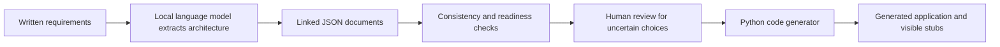

# How the ESUS agent works

This guide describes the current code in simple terms. The project turns written software requirements into an architecture description, checks that description, and generates the parts of a Python application it knows how to build.

## The short version

The agent does not ask a language model to write an entire application in one shot. It uses a local language model to make a series of smaller decisions, saves those decisions as JSON files, checks that they fit together, and then uses Python code to generate supported parts of the application.



The human review stage is used with `--chat`. Without it, the extraction and checks can be run separately, and the generator still refuses output with blockers or unanswered ties.

## How a run works

### 1. Give it requirements and a model

The input is a text description of the program. The extractor also needs a local GGUF model file, which it loads through `llama.cpp` using `llama-cpp-python`.

### 2. Turn the description into architecture documents

The extractor asks the model for one kind of information at a time. It records the results as JSON documents, including:

- the program's key phrases and intentions;
- data entities and their fields;
- application error types and business rules;
- the program's interface and command-line surface;
- service methods and their inputs and outputs;
- method-pattern classifications;
- mappings from user actions to service methods; and
- persistence interfaces when the program needs to store data.

Each step can use names produced by earlier steps. For example, a service method can refer to an entity from the data model. The extractor uses JSON grammars to restrict the structure of its answers and, in many steps, the names it can choose. This reduces mismatches between documents, but it cannot guarantee that the model interpreted the requirements correctly.

If a step produces invalid JSON or hits its output limit, the extractor can retry it. The run log records generation, retries, and repairs. A run can also resume from a selected step using the saved documents.

### 3. Check the documents

The consistency checker looks for problems such as malformed JSON, unknown names, mismatched fields or keys, missing interface methods, and disagreements between the declared command line and the requirements it can inspect.

The readiness probe adds the generator's practical needs. It checks that commands have methods behind them, required input fields can be supplied, and the method patterns are usable. It reports blockers separately from lower-confidence or other residual risks.

These checks answer “do the documents fit together well enough for this generator?” They do not prove that every requirement was captured or that the program's business behavior is correct.

### 4. Resolve uncertain choices

With `--chat`, the tool runs the readiness probe and can ask a person to resolve close method-pattern choices, duplicate interface entries, field-to-input mappings, and missing implementation details for supported method patterns. It then resumes the relevant extraction step when that can help. It keeps a rerun only when the blocker count improves; otherwise it restores the previous documents.

Some blockers cannot be answered in a review question. They need a clearer requirement or a change to the code.

### 5. Generate Python code

`generator.py` first checks readiness. If blockers or unanswered ties remain, it refuses to generate the application.

For accepted architecture documents, the generator creates a `generated/` directory with Python modules for models, errors, storage, repositories, services, and the command-line interface. It generates straightforward data operations and supported patterns mechanically. It also reports how many method bodies were implemented and how many remain stubs.

Unsupported or underspecified business behavior is left as an explicit `NotImplementedError` stub with a reason in the docstring. This makes unfinished work visible rather than silently guessing an implementation. Some supported patterns can be completed after a person supplies the required details.

There are two current scope limits in the code generator:

- generated command-line programs use Python's standard-library `argparse`, even if the architecture names another CLI library;
- generated GUIs are generic `pyimgui` CRUD screens. Other GUI technologies and bespoke screen behavior are not currently generated.

If the architecture is clean but empty, `generator.py --model MODEL.gguf` uses a separate language-model fallback to write a single `app.py` directly from the requirements. That path does not use the detailed architecture-to-code generation path, so its result needs especially careful review.

## Running the main steps

Replace the model and requirements paths with files on your machine:

```bash
python3 extract_arch.py \
  --model /path/to/model.gguf \
  --output out/my-app \
  --requirements prompts/my-app.txt \
  --check
```

To include the interactive review loop, add `--chat`. The requirements must be passed with `--requirements` in that mode so standard input stays available for review answers.

You can inspect readiness separately:

```bash
python3 probe_readiness.py --dirs my-app:out/my-app
```

When the documents are ready, generate the Python files:

```bash
python3 generator.py out/my-app
```

The generated files are written under `out/my-app/generated/`. Read the generator's summary and inspect any reported stubs before treating the application as complete.

## A practical review of the design

The strongest design choice is the use of intermediate documents. They make the model's interpretation inspectable, let the checks point to specific mismatches, and give the generator a defined input. Chaining names between steps is also more reliable than asking several independent model calls to invent the same names consistently.

The main limitation is the boundary between structural consistency and correctness. The checks can catch many disagreements, but they cannot judge every business rule or prove that the original description was understood. Generated code is also intentionally partial when a method needs behavior the generator cannot implement safely. A successful readiness check means the generator's known requirements are met; it is not a substitute for reviewing and running the generated application against real examples.

For a Sfeir.dev article, a concise way to describe the approach is: **use the model to produce small, reviewable architecture decisions; use ordinary code to connect and validate those decisions; generate only what can be implemented mechanically; and keep uncertainty visible for a person to resolve.**

## Where to look in the project

- `extract_arch.py` runs extraction, optional review, and resume logic.
- `kernel/extraction/` contains the prompts, grammars, model runner, and extraction pipeline.
- `kernel/consistency/` contains checks over the saved architecture documents.
- `probe_readiness.py` decides whether the documents are ready for code generation.
- `review_*.py` contains the interactive human-review steps.
- `generator.py` writes the generated Python application.
